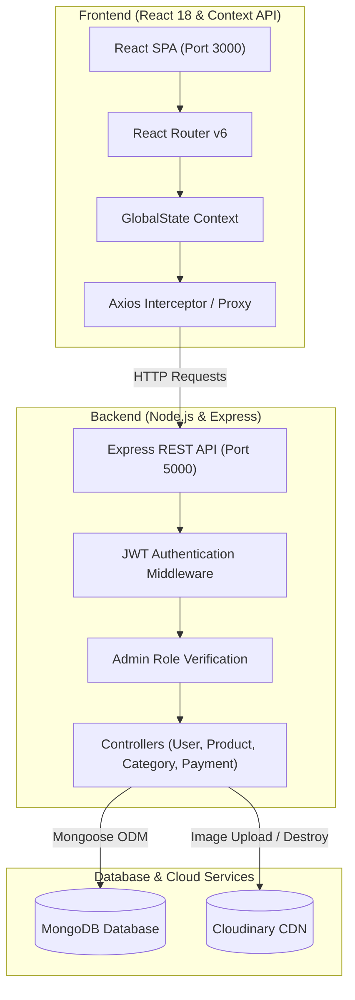
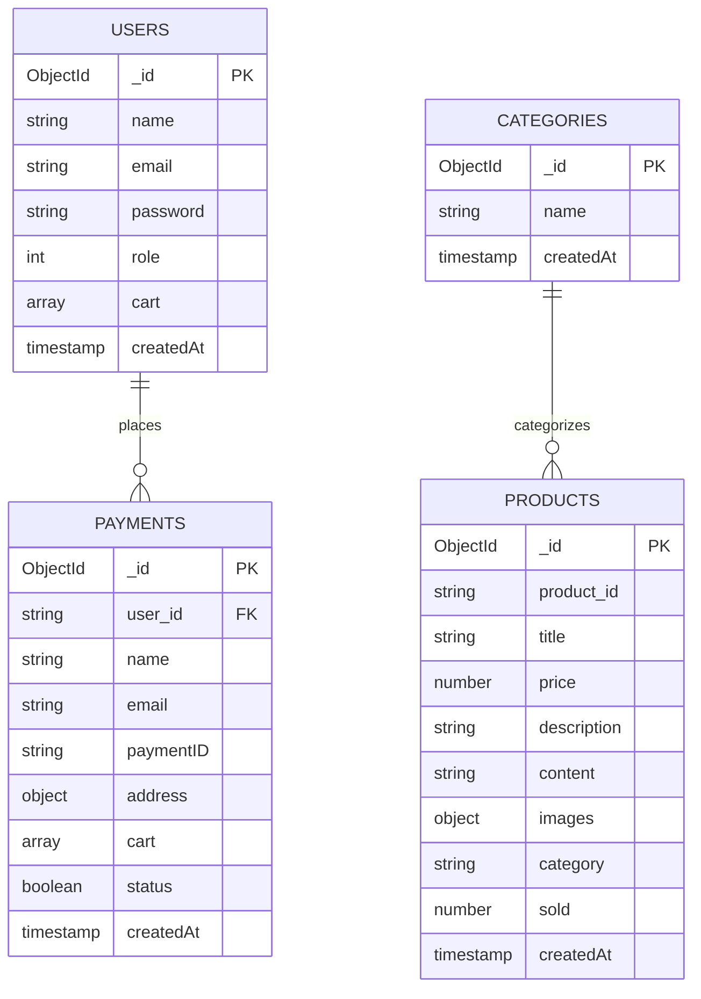

# 🛍️ NovaMart — Full-Stack MERN E-Commerce Platform

A production-ready, feature-rich **MERN (MongoDB, Express.js, React, Node.js)** e-commerce web application with role-based access control (Admin & Customer), real-time product filtering, Cloudinary image hosting, stateful shopping cart, and order processing workflows.

---

## 🌟 Key Features

### 👤 Customer Experience
- **Product Catalog & Discovery**: Instant search by title, category filtering, and sorting (Newest, Oldest, Best Sales, Price: Low-to-High, Price: High-to-Low).
- **Product Details & Related Items**: Dedicated product detail view with image gallery, specs, stock/sales metrics, and automatically recommended related products within the same category.
- **Cart Management**: Persistent shopping cart synced with user account and database, enabling real-time quantity adjustment, item removal, and subtotal calculation.
- **Checkout & Order Placement**: Integrated checkout with shipping address capture and automatic stock/sold-unit tracking.
- **Order History**: Personal purchase log tracking all orders, delivery details, timestamps, and itemized breakdown.

### 🛡️ Administrator Capabilities
- **Role-Based Access Control**: Dual-tier authentication using secure JWT HTTP-Only cookies protecting sensitive administrative endpoints.
- **Product Management (CRUD)**: Add, edit, or delete items. Supports Cloudinary direct image upload or direct image URLs.
- **Batch Operations**: Bulk selection and deletion of products directly from the shop grid.
- **Category Management**: Real-time creation, editing, and deletion of categories with integrity validation.
- **Global Order Tracking**: Real-time visibility into all customer orders and transaction records across the platform.

---

## 🏗️ System Architecture



---

## 🗄️ Database Models



---

## 🔌 RESTful API Endpoints

### 1. Authentication & User Management (`/user`)
| Method | Endpoint | Description | Access |
|---|---|---|---|
| `POST` | `/user/register` | Register new user account | Public |
| `POST` | `/user/login` | Authenticate user & issue JWT | Public |
| `GET` | `/user/logout` | Clear refresh token cookie | Public |
| `GET` | `/user/refresh_token` | Issue new access token | Public |
| `GET` | `/user/infor` | Fetch current authenticated user info | Private (User) |
| `PATCH` | `/user/addcart` | Persist user shopping cart | Private (User) |
| `GET` | `/user/history` | Retrieve user order history | Private (User) |

### 2. Category Management (`/api/category`)
| Method | Endpoint | Description | Access |
|---|---|---|---|
| `GET` | `/api/category` | Retrieve all categories | Public |
| `POST` | `/api/category` | Create new category | Private (Admin) |
| `PUT` | `/api/category/:id` | Update category name | Private (Admin) |
| `DELETE` | `/api/category/:id` | Delete category | Private (Admin) |

### 3. Product Catalog (`/api/products`)
| Method | Endpoint | Description | Access |
|---|---|---|---|
| `GET` | `/api/products` | Retrieve products (with search, sort, filter, pagination) | Public |
| `POST` | `/api/products` | Create new product | Private (Admin) |
| `PUT` | `/api/products/:id` | Update product details | Private (Admin) |
| `DELETE` | `/api/products/:id` | Delete product | Private (Admin) |

### 4. Image Upload & Payments (`/api`)
| Method | Endpoint | Description | Access |
|---|---|---|---|
| `POST` | `/api/upload` | Upload image to Cloudinary | Private (Admin) |
| `POST` | `/api/destroy` | Delete image from Cloudinary | Private (Admin) |
| `GET` | `/api/payment` | Get all orders | Private (Admin) |
| `POST` | `/api/payment` | Submit new order checkout | Private (User) |

---

## 🚀 Quick Start Guide

### Prerequisites
- [Node.js](https://nodejs.org/) (v16 or higher)
- [MongoDB](https://www.mongodb.com/) (Local instance or MongoDB Atlas URI)

### Option A — 1-Click Launch (Windows)
Double-click `START_ECOMMERCE.bat` in the project root. It will automatically:
1. Boot the backend server on `http://localhost:5000`
2. Boot the React client on `http://localhost:3000`

---

### Option B — Manual Command Line Setup

#### 1. Configure Environment Variables
Inside `server/.env`, verify or update your database connection:
```env
PORT=5000
MONGODB_URL=mongodb://127.0.0.1:27017/ecommerce
# Or MongoDB Atlas:
# MONGODB_URL=mongodb+srv://<username>:<password>@cluster0.mongodb.net/ecommerce?retryWrites=true&w=majority

ACCESS_TOKEN_SECRET=medware_ecommerce_access_token_secret_key_2026
REFRESH_TOKEN_SECRET=medware_ecommerce_refresh_token_secret_key_2026
CLIENT_URL=http://localhost:3000

# Cloudinary Configuration
CLOUD_NAME=djfxhuwtz
CLOUD_API_KEY=771885943597754
CLOUD_API_SECRET=cjqFycRflToRaqJiih4ENJJwpZ8
```

#### 2. Seed Database (Optional but Recommended)
Populate your database with rich sample data (Electronics, Wearables, Audio, plus default admin and customer accounts):
```bash
cd server
npm run seed
```
> **Default Test Accounts:**
> - **Administrator**: `admin@example.com` / `admin123` (Access to Admin Dashboard, Category & Product CRUD)
> - **Customer**: `user@example.com` / `user123` (Standard shopping, cart, and checkout)

#### 3. Start Backend Server
```bash
cd server
npm run dev
```

#### 4. Start React Frontend
In a new terminal:
```bash
cd client
npm start
```

Visit **`http://localhost:3000`** in your browser.

---

## 📦 Tech Stack Details

| Layer | Technologies |
|---|---|
| **Frontend** | React 18, React Router v6, Axios, React Icons, Context API |
| **Backend** | Node.js, Express.js, Mongoose ODM, JWT, BcryptJS |
| **File Handling** | Express-FileUpload, Cloudinary API |
| **Database** | MongoDB (Document Store) |
| **Tooling & Ops** | Concurrently, Nodemon, NPM |

---

## 📄 License
This project is open-source and available under the [MIT License](LICENSE).

